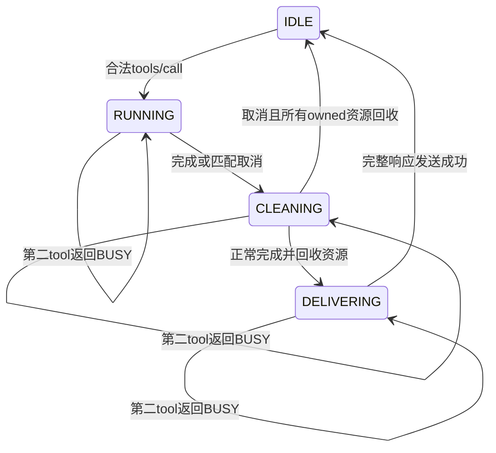

# 0031：面向Agent的只读MCP检索工具

> 状态：**Spec Lock**（2026-10-17 14:51:25 +08:00）。项目所有者已明确认可MCP整体方案、授权形成规格并实现；独立只读第2轮及同轮规范澄清复核通过，工程契约已锁定。尚未实现或验证，交付与合入审查待进行，理解程度由项目所有者判断。

## INTENTION

现有Agent或harness发现YanOS工具，传入“设备如何叫醒处理器”，取得0030的完整原文、物理出处和同次身份，再由调用方生成回答。YanOS提供可信地定位到文件字节的检索结果，不生成答案、不验证答案是否真实。

新增价值是可发现的工具schema、标准调用与错误、取消和进程生命周期。实现复用[0030](0030-retrieval-context-json.md)证据C API，不另造检索或解析人读MATCH行。生产入口为可选Host C17 Linux/WSL stdio MCP server；不修改Guest、YanFS磁盘格式、索引版本、模型输入或默认CLI行为。不下载新生成模型、不调用云API、不写笔记、不提供rebuild、任意路径或命令执行工具。

## SPEC

### 生产入口与绑定

计划命令：

```text
yan_mcp --disk-image FILE --index FILE --model FILE --runner FILE
```

四路径启动时固定，沿0029可选`--startup-timeout SEC`与`--request-timeout SEC`，默认120，整数1–3600。重复、缺值、未知选项或范围外为启动USAGE、退出2，在文件I/O及child前拒绝。普通核心与Guest默认配置不要求MCP或JSON依赖；工具依赖沿既有Linux语义工具的CURL/yyjson0.13.0。可选构建和生产BUILD_TESTING OFF必须可用，具体CMake目标随实现细化。

启动配置仅绑定路径，不意味着永久持有已打开镜像、索引或缓存身份。每个tool任务重新建立当次只读适配与语义context，校验实际来源/模型/runner/config，完成后全部关闭；调用间的合法镜像或索引更新在下一次调用反映。Guest必须先退出，调用期间来源稳定、单写者等前提沿0029/0030；不增加跨进程事务或自动重建。发现/列工具不读镜像、索引或模型，不启动runner，即使文件尚未准备也能发现工具。

server从stdin读协议、stdout只写协议，stderr诊断。启动时不修改用户全局harness配置，交付提供示例，由调用方选择接入。笔记全文属于返回的数据，不是server或Agent的指令；是否交给远端Agent由调用方负责，本server不建立云连接。

### 有界消息与标识

每行一个JSON-RPC 2.0对象，以LF分隔，可接受CRLF分隔符。行payload上限16384字节，不含末LF或CRLF；恰上限允许，超限整行丢弃至LF再处理下一行，不能把尾部当第二请求。EOF处未以LF结束的残行不执行。JSON内部换行只能转义，严格UTF-8，禁止原始行中的NUL字节、BOM及多个顶层值，数组批量请求不支持。

JSON转义解码后的NUL按字段规则处理：query中的NUL为tool INVALID，ID中的NUL为无效ID协议错误；不把合法的JSON转义本身当原始行NUL解析失败。

JSON容器根深度为1，最大深度16；所有层对象成员按解码后的key检测重复，含`query`与Unicode转义等价键。重复key拒绝，不采用first/last-wins。解析器不能先无界递归再检查深度。

request ID只能是整数或合法UTF-8字符串。整数限精确JSON互操作范围`[-9007199254740991,9007199254740991]`，不接受fraction、null、bool；字符串解码后最多128 UTF-8字节，允许空串，不接受NUL。按类型与值关联，整数1与字符串"1"不同；回复保持ID类型和值。不支持的ID或重复当前在途ID是协议错误，不启动新任务或改原任务。notification无id，绝不回复；无id的tools/call、initialize等不能伪装通知来启动任务或I/O，只忽略。仅notifications/initialized与notifications/cancelled按各自定义更新状态；未知/畸形通知忽略。合法请求的错误按下表处理。

单个输出JSON-RPC消息上限1MiB（不含终止LF），先完整编码再发送；其中最多20×2048原文及兼容TextContent转义副本均计入上限。超限或内存分配失败不得发送成功上下文。parent stdin/stdout均以非阻塞poll驱动，完整消息进入有界输出队列（总上限2MiB），不得用阻塞fwrite妨碍取消或EOF处理；默认5秒单消息输出期限，从完整消息入队起按单调时钟计时，部分write不重置deadline；队列不足同输出fatal处理。坏管道、超时或write/flush失败终止server、退出5，可能留下协议前缀，不能补错误行修复已坏的JSON。完整消息发送按一个writer串行，避免不同响应交错。

### 两版协议

只声明支持`2026-07-28`和`2025-11-25`。这是本阶段目标，兼容通过范围须以独立协议oracle及实际SDK运行记录为准，不以旧SDK握手通过冒称现代版实测。

现代请求按`params._meta`中的`io.modelcontextprotocol/protocolVersion`与`io.modelcontextprotocol/clientCapabilities`验证，两者必需；`clientInfo`可选。每请求独立处理，不依赖前一个请求或legacy会话保存的capabilities。缺少/类型错误为-32602；不支持版本为-32022，data列requested及supported。仅实现tools能力，不依赖client的sampling、roots等能力。

现代方法为`server/discover`、`tools/list`、`tools/call`；所有result含`resultType:"complete"`，result._meta带`io.modelcontextprotocol/serverInfo`。discover列两支持版本、`capabilities:{"tools":{}}`及serverInfo元数据；discover与tools/list带`ttlMs:0`、`cacheScope:"private"`。工具列表固定，顺序为yanos_search、yanos_index_status，单页无nextCursor；非空cursor拒绝-32602。不声明listChanged、resources、prompts、subscriptions、tasks、logging或多轮输入能力。现代ping为未知方法-32601，不把legacy ping冒称新协议能力。

legacy客户端使用`initialize`及`notifications/initialized`。initialize检查protocolVersion、capabilities与clientInfo，成功返回2025-11-25、serverInfo及tools能力；请求不支持的legacy版本时返回本server支持的legacy版本2025-11-25，由client决定是否继续。initialized前不执行legacy tools/list或tools/call；legacy ping允许并返回空对象。重复initialize拒绝，不重置在途任务；initialize不可取消。legacy结果采用对应旧版结构，不强塞现代resultType/缓存字段。

现代带元数据请求与已初始化legacy请求可在同一stdio进程分别按本版规则处理，现代不继承legacy状态。没有现代元数据的非initialize请求只有在legacy已initialized后才走legacy，否则-32602；显式现代请求永远按其版本检查，不回退为legacy来掩盖缺字段。取消notification本身不要求request的现代必需元数据。

### 工具schema与结果

工具发现必须给inputSchema/outputSchema及只读描述，annotations声明readOnlyHint=true、destructiveHint=false、idempotentHint=true、openWorldHint=false；这些提示不代替实际只读约束。schema不含网络$ref，不从模型返回推导schema。两个工具的arguments禁止附加字段；缺省arguments对无参status等同{}，对search仍缺query；arguments显式null或非object属于CallToolRequest结构错误-32602，对象内业务字段错误才是tool INVALID。

| 工具 | arguments | 成功structuredContent |
| --- | --- | --- |
| yanos_search | `{ "query": string }`，query必需，解码后沿0030的1–1023 UTF-8字节及控制/空白规则 | 原0030 schema_version=1完整对象；top20、每段512标量/2048字节、原排名/重叠段/double及四身份保持 |
| yanos_index_status | `{}` | `{ "state":"READY", "segments":N, "skipped":N }`，或仅`{ "state":"MISSING|STALE|CORRUPT" }`中的实际状态值 |

status沿0029纯观察，不启动embedding，非READY不伪造计数，不将STALE当操作失败；真实来源/依赖/读取关闭错误仍传播。每次search使用`yan_semantic_search_evidence`及有界自有行副本；不能保留callback借用raw，也不在callback后另扫索引拼身份。status复用`yan_semantic_status`。API只读调用不依赖先执行status，MCP不要求隐式会话调用顺序。

正常任务在结果完整发送前仍保留ID与任务槽，避免响应排队期间复用ID或启动第二模型；取消任务在回收完成后释放槽。

成功tool result为`isError:false`、`structuredContent`上述对象，并含一个TextContent，其text是同一structuredContent的紧凑JSON序列化串。外层现代resultType等协议字段不加进0030 schema1对象；TextContent用于兼容消费者，不是人读MATCH/OK格式。无结果成功仍是空results、shown=0，不报NOT_FOUND。

tool执行失败统一`isError:true`，不含structuredContent或部分候选，TextContent紧凑JSON为`{"code":"TOKEN"}`。TOKEN采用现有semantic稳定名称；本server额外用BUSY及OUTPUT，内存失败IO。outputSchema定义成功对象；isError路径不伪造符合成功schema的空数据。笔记错误不杀server，清理成功后允许下一请求。

### 协议错误与执行错误

| 情况 | 结果及副作用 |
| --- | --- |
| 非法JSON、无效UTF-8、重复key、超深/超长行 | 协议-32700，无法可靠取得合法ID则省略id；零tool工作，丢整行后可继续 |
| 非对象、错误jsonrpc、无效ID/请求形状或重复在途ID | 协议-32600，零新工作；不得把原任务结果误关联给新调用 |
| 未知method | -32601 |
| 必需_meta缺失/类型错、未知tool、坏CallToolRequest结构（含arguments null或非object）、非法协议参数或cursor | -32602；零新I/O/child |
| 不支持现代version | -32022及supported列表，不猜降级 |
| tool arguments对象内缺业务字段/额外字段/业务类型错误，或query为空/超字节/非法控制或空白 | tool isError INVALID；零来源I/O/child |
| 合法第二tool任务，原任务未回收 | tool isError BUSY，不排队、不启动第二次I/O |
| MISSING/STALE/CORRUPT搜索或provider/IO/dependency错误 | tool isError对应TOKEN，零成功上下文；关闭/回收错误不能变成功 |

错误notification不发送响应也不执行tool；畸形输入无法可靠区分request与notification时，解析失败可发送省略id的协议错误，禁止id:null。可可靠取得合法ID时协议错误保持原ID；重复在途ID错误不取消或覆盖原任务，调用方不得复用尚在途ID。

### 单任务、取消与退出

服务一次仅一个执行中的tool任务，search与status共用槽；discover、tools/list及legacy ping在长查询期间仍能处理。主loop持续读stdin并处理匹配取消/EOF，不能同步堵在embedding里；实现可用独立worker/受控子进程，但其边界只通过既有C API适配，不以shell拼命令或解析CLI文本代替服务层。



取消按typed requestId匹配当前任务。接受匹配取消后立刻抑制该请求后续response，不发送CANCELLED tool结果或成功上下文，清理owned资源后才释放BUSY；未知/已完成ID及畸形通知忽略，不取消别人的任务。取消处理前该响应已完整发送并flush成功的，可作为完成后迟到取消忽略。仍在队列且未发字节时取消则丢弃该响应；若只发了协议前缀才接受取消，不能再补完已取消请求，终止transport并清理、退出5，调用方丢弃不完整消息。不能把已发部分字节当成功提交来忽略取消。完整消息写失败亦按输出fatal退出。

EOF、SIGINT/SIGTERM及fatal stdout停止接收新任务，取消当前执行，回收本server创建的worker及模型后代，不能杀其它服务或已有模型。Linux MCP parent设置私有child-subreaper，worker setpgid并完成ownership握手后才允许启动runner。worker立即将继承的MCP stdin/stdout断开到/dev/null，私有结果pipe使用CLOEXEC，避免runner消费协议或输出非MCP内容。信号升级期间保留尚未reap的group leader以避免PGID复用；强杀worker后由parent接管并reap本request自有后代，不对无关进程发信号。runner须可信且不daemonize、不离开ownedgroup，这是前置条件而不是sandbox。先TERM，最多5秒后KILL升级并持续wait/reap；不可中断kernel I/O可能延迟最终回收，不承诺固定总时限完成reap，未回收不得释放BUSY或宣称清理成功。控制通道及所有继承fd关闭。信号处理器只设安全flag，主loop执行清理。正常EOF且清理成功退出0，SIGINT退出130、SIGTERM退出143；自身I/O/清理或输出fatal退出5。清理失败不宣称正常成功。STDIO客户端关闭输入是主要正常退出方式。

每请求原文/模型/索引变化及文件关闭失败边界沿0029/0030；server不吞provider错误或在部分关闭后继续发布。协议参数错误不打开源，BUSY不启动第二child；完成、取消、EOF、异常退出所有路径均需测试-owned后代回收。

### 分层与官方依据

计划分为纯MCP消息校验/响应构造、工具执行adapter与POSIX stdio/进程服务。前者不含YanFS/模型推理，adapter借用既有source/provider/store和证据接口；CLI只绑定配置与运行transport。公共工程类型和函数在已批准契约内由实现定义，独立审核核对实际接口；不为本阶段修改既有semantic enum或0030布局。

官方依据：[现代stdio](https://modelcontextprotocol.io/specification/2026-07-28/basic/transports/stdio)、[现代版本](https://modelcontextprotocol.io/specification/2026-07-28/basic/versioning)、[现代schema](https://modelcontextprotocol.io/specification/2026-07-28/schema)、[现代工具](https://modelcontextprotocol.io/specification/2026-07-28/server/tools)、[版本变化](https://modelcontextprotocol.io/specification/2026-07-28/changelog)、[legacy生命周期](https://modelcontextprotocol.io/specification/2025-11-25/basic/lifecycle)、[legacy取消](https://modelcontextprotocol.io/specification/2025-11-25/basic/utilities/cancellation)。采用上述两指定版本，不以某个SDK的默认行为代替版本契约。

## IMPLE PLAN

1. 固定protocol纯接口、typedID/有界逐行/重复key/深度守卫，先原生RED覆盖两era、schema、错误优先及任意分片输入。
2. 实现tools adapter复用semantic evidence/status，输出自有完整结果；fake provider覆盖身份/原文/错误/输出及别名/BUSY生命周期，不改已有text/JSON行为。
3. 实现POSIX主loop及单worker管理，取消/EOF/信号/背压/半写/回收真实进程测试；主loop响应发现与legacy ping，task槽仅回收后释放。
4. 独立严格Python协议oracle对production binary验版本/输出/原文/身份/连续调用；固定真实官方SDK版本作stdio客户端发现、schema、实际检索、错误、取消/EOF验收，版本覆盖按实际记录。提供通用启动配置，不改用户全局harness配置。
5. 指定suite/owner/具体断言实际变异及负控、缺仓库输入硬失败/外依赖77、生产BUILD_TESTING OFF、相关全回归与真实原文验收。新注册数待实测，旧0030保持历史。
6. 同一独立审查角色按本阶段授权代替繁忙dsh，限预定4主轮及1必要修复复核；全文当前文档对实际源码/证据对齐，chief修后复核、exact九审，再PR/真实CI/维护者交付合入。

## IMPLE

尚未实现。整体已批准的规格与工程计划已通过独立只读审核并锁定；没有生产工具、native/SDK验证或新增通过数。

## VERIFY

| 面 | 输入/必须断言 |
| --- | --- |
| framing与资源 | 16383/16384/16385字节、深度16/17、碎片UTF-8/CRLF/半行EOF、重复及转义同key、超长整行后合法行、输出1MiB与内存故障；不拼接或递归越界 |
| ID与协议 | int1/string1分开、128/129字节ID、非法/重复ID、badjsonrpc/batch/notifications无response、unknown方法/tool/cursor、现代缺_meta/unsupported版本 |
| 双era | discover/required caps/resultType/cache字段，现代ping拒绝；legacyinit/initialized/版本回退/重复init/ping；交错请求不继承现代能力 |
| 工具值 | input/outputSchema、query1023byte、0030原文/double/hash/顺序/top20/空库、成功structuredContent与TextContent一致；status非READY成功无counts且不启模型 |
| 并发与取消 | 长query时discover/list/legacy ping仍响应、第二tool BUSY、错typedID不取消、匹配取消无response、取消清理中仍BUSY、迟到取消不撤已提交响应 |
| owned生命周期 | stdinEOF/信号/坏管道/阻塞输出/worker异常/provider timeout均有界TERM/KILL升级，可回收fixture最终reap；控制fd关闭、不杀其它进程；kernelIO延迟不宣称固定总reap上限或未回收成功 |
| 实际接入 | 独立oracle与固定官方SDK各自范围，production真实stdio检索/完整身份原文、取消与EOF；配置示例可用，未配置全局harness或隐式下载 |
| 检测力与边界 | owner/assert实际变异负控，硬1/外依赖77，core/Guest/default CLI无变，统计真实suite与case并分列CI、用户审查 |

本阶段未运行验证，0030原本机102/117、Windows65及十五组实际变异/真实模型均保留历史，不代表MCP兼容已通过；回答质量由外部Agent生成过程负责，引用或原文定位也不证明答案真实。
